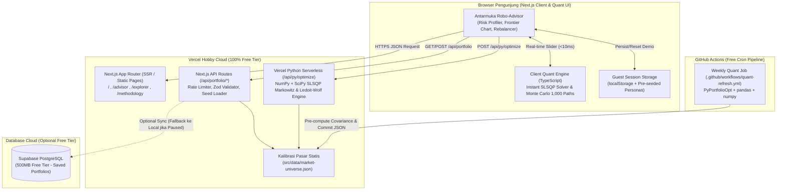
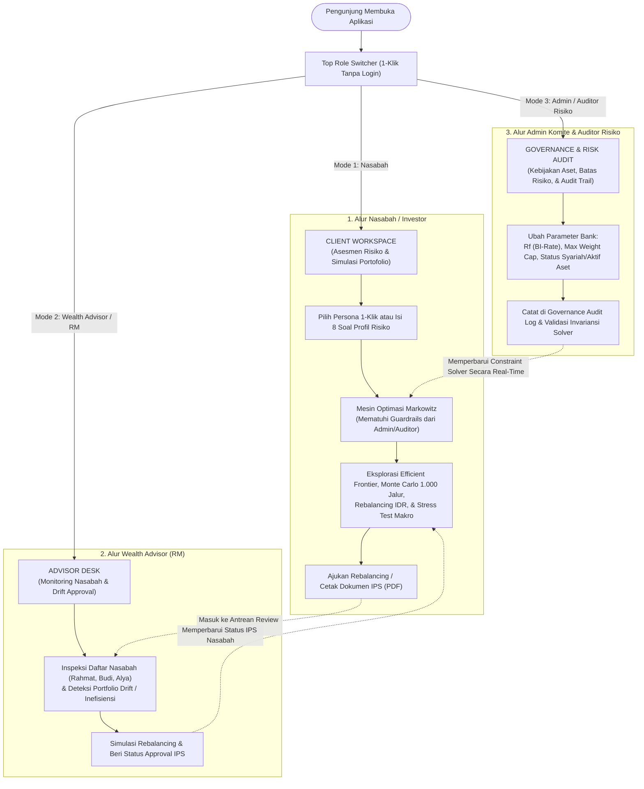
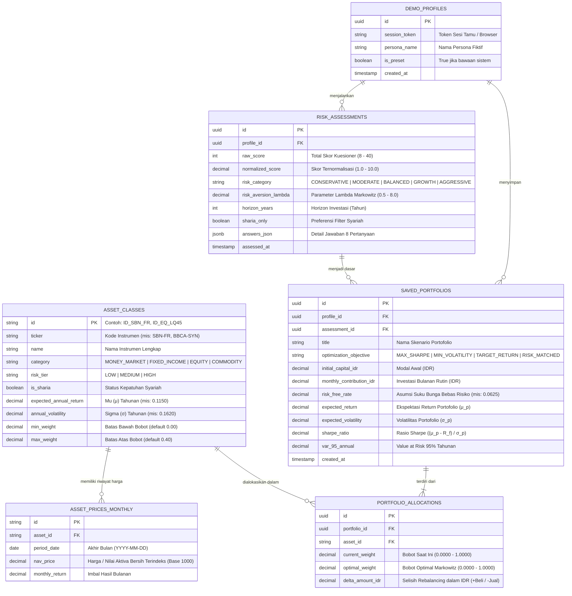

# ARCHITECTURE.md — Robo-Advisor & Optimalisasi Portofolio Investasi (Markowitz Mean-Variance Engine)

> **Status Dokumen:** Blueprint Arsitektur Utama (v1.0.0)  
> **Nomor & Kategori Tracker:** Proyek #26 — Analitik & Pelanggan  
> **Target Deployment:** 100% Gratis & Demo Publik Permanen (Vercel Hobby + GitHub Actions + Supabase/Local Fallback)  
> **Penyusun:** Antigravity (Senior Software Architect & Full-Stack Engineer)  
> **Pelaksana Pondasi:** Codex (ChatGPT) — di bawah supervisi, audit, dan perapihan Antigravity  

---

## Klarifikasi Awal & Asumsi Eksplisit

Sebelum merinci arsitektur teknis, berikut adalah **3 pertanyaan klarifikasi** beserta **asumsi eksplisit** yang langsung diterapkan agar pengerjaan tidak terhambat (Anda dapat mengubah asumsi ini kapan saja sebelum tahap implementasi kode):

1. **Cakupan Instrumen Investasi (Konvensional vs. Syariah):**
   - *Pertanyaan:* Apakah instrumen aset yang dioptimasi difokuskan pada instrumen pasar modal Indonesia (Reksa Dana Pasar Uang, Obligasi Negara/Sukuk Ritel, Saham Bluechip LQ45/JII, Emas) dengan opsi toggle **Filter Portofolio Syariah**?
   - *Asumsi yang dipakai:* **Ya.** Sistem menyediakan 10 kelas aset/instrumen representatif Indonesia & global (data sintetis terkalibrasi secara statistik berdasarkan karakter historis IHSG/LQ45, JII70, SBN/Sukuk, Pasar Uang, dan Emas Antam) lengkap dengan fitur toggle **"Semua Instrumen"** vs **"Khusus Syariah (Sharia-Compliant)"** agar selaras dengan konteks magang perbankan syariah namun tetap universal untuk portofolio teknik finansial.
2. **Arsitektur Mesin Optimasi (Python Serverless vs. Hybrid Client-Server):**
   - *Pertanyaan:* Pada Vercel Hobby (free-tier), paket `PyPortfolioOpt` penuh beserta `cvxpy` sering mendekati batas ukuran bundle 250 MB serverless. Apakah Anda setuju menggunakan arsitektur **Hybrid Dual-Engine** (`Python Serverless API` berbasis `numpy` + `scipy.optimize.minimize` SLSQP yang 100% ekuivalen secara matematis dengan `PyPortfolioOpt`, dipadukan dengan `GitHub Actions PyPortfolioOpt Pipeline` dan `TypeScript Quant Solver` di sisi klien untuk simulasi *real-time* 0ms)?
   - *Asumsi yang dipakai:* **Ya.** Pendekatan ini mematuhi tech stack di Excel Tracker (`Next.js + Python serverless (PyPortfolioOpt)`), menjamin *build* Vercel tidak pernah gagal karena limit 250 MB, serta memberi interaksi grafik *Efficient Frontier* yang instan tanpa *lag* *cold-start*.
3. **Sistem Multi-Peran Tanpa Hambatan Login (1-Click Role Switcher — Nasabah, Wealth Advisor, & Admin Kepatuhan/Auditor Risiko):**
   - *Pertanyaan:* Apakah aplikasi hanya berupa alat analisa satu arah, atau memiliki pembagian peran layaknya sistem perbankan nyata (Nasabah, Relationship Manager/Advisor, dan Admin Komite Investasi/Auditor Risiko)?
   - *Keputusan Arsitektur:* **Menggunakan 3 Peran Operasional Perbankan (`Nasabah / Investor`, `Wealth Advisor / RM`, dan `Admin Komite Risiko & Kepatuhan Syariah`)** yang dapat diganti secara instan melalui **1-Click Role Switcher** di header tanpa perlu form login/registrasi. Semua perubahan kebijakan oleh Admin/Auditor (misal mengubah *Risk-Free Rate* BI, membekukan instrumen aset tertentu, atau memperketat batas bobot maksimum $w_{\max}$) langsung berdampak *real-time* pada mesin optimasi Markowitz di tampilan Nasabah dan Advisor, lengkap dengan pencatatan **Audit Trail**.

---

## 1. Ringkasan & Tujuan Proyek

### 1.1 Masalah yang Diselesaikan
Banyak investor ritel maupun nasabah perbankan menempatkan dana investasi hanya berdasarkan intuisi, tren sesaat, atau menaruh seluruh dana pada satu instrumen tanpa memperhitungkan **korelasi antar-aset (kovariansi)** dan **profil toleransi risiko**. Akibatnya, portofolio yang terbentuk sering kali *sub-optimal*: menanggung volatilitas (risiko) terlalu tinggi untuk tingkat imbal hasil (*expected return*) yang sama, atau sebaliknya memperoleh imbal hasil terlalu rendah untuk tingkat risiko yang diambil.

### 1.2 Solusi yang Ditawarkan
**QuantVault Robo-Advisor** adalah aplikasi web *wealth management* & optimasi portofolio kuantitatif berbasis **Modern Portfolio Theory (MPT) Harry Markowitz**. Sistem ini memandu pengguna melalui:
1. **Asesmen Profil Risiko Multi-Dimensi:** Mengukur kapasitas risiko (horizon waktu, stabilitas arus kas, dana darurat) dan toleransi risiko psikologis (reaksi terhadap *drawdown* pasar) menjadi skor risiko terukur ($1.0 - 10.0$) dan parameter penghindaran risiko ($\lambda$ / *risk aversion*).
2. **Optimasi Portofolio Markowitz (Mean-Variance Optimization):** Menghitung bobot alokasi aset optimal $\mathbf{w}^* = [w_1, w_2, \dots, w_n]^T$ yang berada tepat di kurva **Efficient Frontier** menggunakan *Quadratic Programming / Sequential Least Squares Programming (SLSQP)* dengan matriks kovariansi *Ledoit-Wolf Shrinkage*.
3. **Eksplorasi Interaktif & Simulasi Kekayaan:** Menampilkan kurva *Efficient Frontier*, titik **Maximum Sharpe Ratio**, **Minimum Volatility**, **Target Return**, perbandingan dengan portofolio saat ini (*Current vs. Optimal*), kalkulator *Rebalancing* dalam Rupiah (IDR), serta proyeksi kekayaan masa depan berbasis **Simulasi Monte Carlo** (1.000 jalur *Geometric Brownian Motion*) dan *Historical Stress-Testing*.

### 1.3 Nilai Portofolio (Portfolio Value Proposition)
- **Kedalaman Kuantitatif & Finansial:** Membuktikan pemahaman nyata atas matematika keuangan (*Mean-Variance Optimization*, *Sharpe Ratio*, *Sortino Ratio*, *Value at Risk / CVaR 95%*, *Maximum Drawdown*, *Correlation Matrix*), bukan sekadar aplikasi CRUD biasa.
- **Standar Desain Institusional (Anti-AI-Slop):** Dirancang dengan estetika *Swiss Financial Grid* (setara terminal kekayaan modern seperti Linear, Bloomberg, dan Vanguard Digital Advisor) dengan tipografi *tabular numerals*, hirarki data padat namun bersih, dan grafik kanvas/SVG presisi tinggi.
- **100% Gratis, Tahan Banting, dan Siap Demo:** Berjalan penuh di Vercel Hobby dengan *uptime* 100% berkat arsitektur *Hybrid Python Serverless + Deterministic Client Quant Engine* dan dataset pasar terkalibrasi.

---

## 2. Fitur

### 2.1 Fitur Inti (MVP — Wajib Ada)
Sesuai dengan spesifikasi pada Excel Tracker Proyek #26:
1. **Kuesioner Profil Risiko Interaktif (8 Pertanyaan Terbobot):**
   - Menilai horizon investasi, tujuan keuangan, rasio likuiditas, dan toleransi penurunan nilai (*drawdown tolerance*).
   - Menghasilkan klasifikasi profil: **Konservatif**, **Moderat-Konservatif**, **Moderat**, **Moderat-Agresif**, atau **Agresif**, beserta nilai parameter *Risk Aversion* ($\lambda$) dan batas maksimum eksposur aset berisiko.
2. **Eksplorasi Data Harga Historis & Matriks Korelasi Aset:**
   - Dataset harga historis publik/sintetis terkalibrasi (5 tahun data harian/bulanan untuk 10 kelas aset: Pasar Uang, Deposito/Sukuk Tabungan, Obligasi Negara FR, Sukuk Ritel SR, Saham Bluechip Perbankan, Saham Konsumer, Indeks Syariah JII, Emas, ETF Global Tech, dan Kas).
   - Tabel metrik tiap aset (*Annualized Return*, *Annualized Volatility*, *Sharpe Ratio*, *Max Drawdown*) dan visualisasi **Heatmap Matriks Korelasi** ($\rho_{ij}$).
3. **Mesin Optimasi Portofolio Markowitz (3 Objektif + Kendala Kustom):**
   - **Maximum Sharpe Ratio** (Portofolio Tangensi terbaik secara *risk-adjusted*).
   - **Minimum Volatility** (Titik risiko paling rendah pada kurva).
   - **Risk-Profile Matched / Target Return** (Portofolio efisien yang disesuaikan dengan skor profil risiko pengguna).
   - Kendala (*Constraints*) yang dapat diatur: *Long-only* ($w_i \ge 0$), batas bobot maksimum per aset ($w_{\max}$, misal $35\%$ untuk mencegah konsentrasi berlebih), dan filter **Sharia-Compliant Only**.
4. **Grafik Interaktif Efficient Frontier & Capital Allocation Line (CAL):**
   - Memvisualisasikan kurva *Efficient Frontier* (50 titik portofolio efisien), 300+ titik *Simulated Sub-Optimal Portfolios* (awan Monte Carlo), posisi aset individual, titik **Max Sharpe**, titik **Min Volatility**, dan titik **Portofolio Pilihan Pengguna**.
5. **Simulasi Hasil Investasi (Historical Backtest & Proyeksi Monte Carlo):**
   - Simulasi pertumbuhan modal awal (misal Rp 100.000.000) + kontribusi bulanan rutin (DCA) selama $1 - 20$ tahun.
   - Menampilkan pita probabilitas Monte Carlo: Skenario Optimis (*Percentile 90*), Ekspektasi Median (*Percentile 50*), dan Skenario Pesimis/Risiko Buruk (*Percentile 10*), lengkap dengan estimasi *Value at Risk (VaR 95%)*.

### 2.2 Fitur Tambahan (Nice-to-Have — Pembeda Portofolio)
1. **Kalkulator Rebalancing Portofolio (Current vs. Recommended):**
   - Pengguna dapat memasukkan komposisi portofolio mereka saat ini (dalam % atau Nominal Rupiah), melihat seberapa jauh posisi portofolio mereka di bawah kurva *Efficient Frontier* (*efficiency gap*), dan mendapatkan instruksi aksi beli/jual (*BUY / SELL / HOLD*) dalam Rupiah untuk mencapai portofolio optimal.
2. **Simulasi Stress-Test Makroekonomi:**
   - Menguji ketahanan portofolio terhadap 3 skenario historis: *Guncangan Pandemi 2020*, *Kenaikan Suku Bunga Global 2022*, dan *Krisis Likuiditas Pasar Berkembang*.
3. **Pembaruan Data Otomatis via GitHub Actions (`PyPortfolioOpt` Batch Job):**
   - Workflow terjadwal mingguan yang menjalankan skrip Python `PyPortfolioOpt` untuk memperbarui parameter *expected return* dan matriks kovariansi Ledoit-Wolf ke file JSON statis terverifikasi.
4. **Ekspor Laporan Investment Policy Statement (IPS):**
   - Mencetak/mengunduh ringkasan rekomendasi portofolio dalam format cetak PDF/JSON yang rapi layaknya dokumen resmi manajer investasi.

### 2.3 Prioritas Pengerjaan (MoSCoW Matrix)

| Prioritas | Fitur | Target Waktu |
| :--- | :--- | :--- |
| **P0 (Must Have)** | Mesin Kuantitatif Markowitz (Python API + TS Solver), Dataset 10 Kelas Aset, Kuesioner Profil Risiko, Grafik Efficient Frontier, Alokasi Bobot Optimal | Hari 1–2 |
| **P1 (Should Have)** | Simulasi Proyeksi Monte Carlo & Historical Backtest, Heatmap Matriks Korelasi, Mode Demo 1-Klik (3 Persona), Filter Syariah | Hari 2–3 |
| **P2 (Could Have)** | Kalkulator Rebalancing (Current vs. Optimal IDR), Stress-Testing Skenario Makro, Ekspor Laporan IPS (Print-to-PDF) | Hari 3–4 |
| **P3 (Nice to Have)** | GitHub Actions Cron untuk `PyPortfolioOpt` EOD Data Refresh, Sinkronisasi Opsional ke Supabase Postgres | Hari 4 |

---

## 3. Tech Stack & Alasan Pemilihan

Seluruh komponen dipilih agar **100% gratis selamanya (tanpa kartu kredit)**, bebas *vendor lock-in*, dan berjalan mulus di **Vercel Hobby Plan**:

| Lapisan | Teknologi yang Dipilih | Alasan Pemilihan & Kecocokan Free-Tier |
| :--- | :--- | :--- |
| **Frontend Framework** | **Next.js 15 (App Router) + React 19 + TypeScript 5** | Standar industri modern, mendukung SSR/SSG dan Route Handlers di Vercel secara native dengan *zero configuration*. |
| **Backend / Quant API** | **Vercel Python Serverless Functions (`api/optimize.py`) + Next.js Route Handlers** | Menjalankan algoritma optimasi Markowitz berbasis Python (`numpy` + `scipy.optimize.minimize` SLSQP) sesuai syarat Tracker #26, sekaligus tetap berada di bawah limit bundle 250 MB Vercel Hobby. |
| **Client Quant Engine** | **TypeScript Quantitative Solver (`src/lib/quant/`)** | Mesin solver Quadratic Programming & Monte Carlo di sisi klien sehingga slider *target return*, *max weight constraint*, dan *frontier hover* bereaksi dalam $<10\text{ ms}$ bahkan saat offline atau saat serverless mengalami *cold start*. |
| **Batch Data Pipeline** | **Python `PyPortfolioOpt` + GitHub Actions (Cron)** | Menjalankan pustaka `PyPortfolioOpt` penuh (Ledoit-Wolf shrinkage, Black-Litterman prior, EfficientFrontier) di runner gratis GitHub Actions (2.000 menit/bulan) dan menyimpan snapshot matriks di `src/data/market-snapshot.json`. |
| **Database & Persistence** | **Hybrid: LocalStorage + Static Seed JSON (Default) + Supabase Postgres (Opsional Free Tier)** | Mode demo langsung berfungsi 100% tanpa database eksternal. Jika `NEXT_PUBLIC_SUPABASE_URL` diisi, riwayat asesmen dan portofolio pengguna tersimpan di Supabase Free Tier (500 MB). |
| **Styling & Design System** | **Tailwind CSS v4 + CSS Variables (Swiss Financial Grid)** | Ringan, tidak ada overhead runtime CSS-in-JS, mendukung tema *Light (Institutional Paper)* dan *Dark (Terminal Carbon)* dengan kontras WCAG AA. |
| **Visualisasi Data** | **Custom High-DPI SVG / Canvas Charts + Recharts (Lightweight)** | Komponen SVG kustom untuk *Efficient Frontier Scatter/Curve* dan *Correlation Heatmap* menjamin kontrol piksel penuh, *tooltip* finansial presisi tinggi, dan bebas tampilan grafik generik (*anti-AI-slop*). |
| **Validasi & Skema** | **Zod** | Validasi ketat pada payload API (bobot aset, batas risiko, matriks kovariansi positif-semidefinit) di frontend maupun backend. |
| **Testing & Quality** | **Vitest + Playwright / React Testing Library** | Memastikan invariansi matematika (jumlah bobot $\sum w_i = 1.0$, $w_i \ge 0$, portofolio Max Sharpe memiliki rasio Sharpe tertinggi di seluruh kurva). |

---

## 4. Arsitektur Sistem

Berikut adalah diagram arsitektur sistem secara menyeluruh yang menggabungkan klien, Vercel Serverless (Node.js & Python runtime), pipeline GitHub Actions `PyPortfolioOpt`, dan penyimpanan hibrida:



---

## 5. Alur Pengguna & Multi-Peran Perbankan (User & Role Flow)

Agar mencerminkan alur kerja nyata di divisi *Wealth Management* dan *Manajemen Risiko* perbankan (namun tetap 100% ramah pengunjung portofolio tanpa penghalang login), aplikasi menyediakan **1-Click Role Switcher** dengan 3 peran yang saling terintegrasi:

1. **Peran 1: Nasabah / Investor Ritel (`CLIENT WORKSPACE`)**
   - Mengisi 8 pertanyaan kuesioner profil risiko (atau memuat 1 dari 3 persona nasabah: *H. Rahmat — Konservatif Syariah*, *Budi — Moderat*, *Alya — Agresif*).
   - Mengatur modal awal, DCA bulanan, melihat kurva *Efficient Frontier*, tabel alokasi optimal, proyeksi *Monte Carlo*, instruksi *Rebalancing* (`BUY`/`SELL` IDR), dan mencetak dokumen *Investment Policy Statement (IPS)*.
2. **Peran 2: Wealth Advisor / Relationship Manager (`ADVISOR DESK`)**
   - Memantau daftar portofolio seluruh nasabah kelolaan (*Client Book Overview*), mendeteksi nasabah yang portofolionya mengalami *Portfolio Drift* (menyimpang jauh di bawah kurva efisien atau melanggar batas risiko), menjalankan *Tactical Rebalance Review*, dan memberikan status persetujuan (*Advisor Approved / Needs Rebalancing*).
3. **Peran 3: Admin Komite Investasi & Auditor Risiko/Syariah (`GOVERNANCE & RISK AUDIT`)**
   - Mengatur parameter kebijakan makro bank (*Bank Policy Guardrails*): mengubah asumsi *Risk-Free Rate* ($R_f$, misal kupon SBN/BI-Rate $6.25\%$), menetapkan plafon konsentrasi maksimum per aset ($w_{\max}$), mengaktifkan/menonaktifkan instrumen di *Asset Universe*, memverifikasi kepatuhan **Dewan Pengawas Syariah (DPS)** pada tiap aset, serta mengaudit log perubahan kebijakan (*Governance Audit Log*) dan verifikasi matematis *Solver Invariance Check* (TypeScript vs Python SLSQP).



---

## 6. Desain Database & Struktur Data

Meskipun aplikasi dapat berjalan **100% *stateless* + `localStorage`** pada mode demo agar tidak pernah gagal jika database cloud *paused*, skema database relasional (PostgreSQL untuk Supabase / SQLite untuk Turso) tetap dirancang secara baku dan digunakan baik untuk struktur penyimpanan JSON lokal maupun tabel cloud.

### 6.1 Diagram Entity-Relationship (ERD)



### 6.2 Daftar Universe Aset Fiktif Terkalibrasi (10 Instrumen Standar)
Seluruh data di bawah ini adalah **data sintetis terkalibrasi** (tidak mengambil data rahasia bank mana pun, melainkan merepresentasikan karakteristik statistik kelas aset pasar keuangan Indonesia selama 60 bulan terakhir):

| ID Aset | Kode | Nama Instrumen | Kategori | Syariah | Return Tahunan ($\mu$) | Volatilitas ($\sigma$) |
| :--- | :--- | :--- | :--- | :---: | :---: | :---: |
| `MM_PUAS` | `RDPU-SYA` | Pasar Uang Syariah & Deposito Mudharabah | Pasar Uang | Ya | $5.40\%$ | $0.85\%$ |
| `MM_CONV` | `RDPU-KON` | Reksa Dana Pasar Uang Likuid | Pasar Uang | Tidak | $5.65\%$ | $0.90\%$ |
| `FI_SUKUK` | `PBS-SR01` | Sukuk Negara Ritel & Proyek (SBSN) | Pendapatan Tetap | Ya | $6.85\%$ | $3.20\%$ |
| `FI_SBN` | `SBN-FR95` | Obligasi Negara Fixed Rate (SBN) | Pendapatan Tetap | Tidak | $7.10\%$ | $4.10\%$ |
| `FI_CORP` | `SUK-KORP` | Sukuk Korporasi Grade AAA | Pendapatan Tetap | Ya | $7.90\%$ | $4.85\%$ |
| `EQ_JII` | `IDX-JII70` | Ekuitas Unggulan Syariah (JII-70 Index Proxy) | Saham | Ya | $11.80\%$ | $16.40\%$ |
| `EQ_LQ45` | `IDX-LQ45` | Ekuitas Bluechip Nasional (LQ45 Index Proxy) | Saham | Tidak | $12.40\%$ | $17.20\%$ |
| `EQ_DIV` | `IDX-HIDIV` | Ekuitas Dividen Tinggi & Perbankan | Saham | Tidak | $13.20\%$ | $18.50\%$ |
| `EQ_TECH` | `GLB-SHARIA` | Ekuitas Teknologi & Kesehatan Global Syariah | Saham Global | Ya | $14.90\%$ | $22.80\%$ |
| `CM_GOLD` | `GOLD-ANTM` | Emas Murni Fisik / Digital (Hedging Inflasi) | Komoditas | Ya | $9.60\%$ | $12.10\%$ |

---

## 7. Struktur Folder Proyek

Struktur folder dirancang bersih, modular, dan memisahkan antara **UI Presentational Components**, **Quantitative Financial Engine (TypeScript & Python)**, serta **Static Calibrated Dataset**:

```text
3. Robo-Advisor & Optimalisasi Portofolio Investasi/
├── .agents/
│   └── skills/
│       ├── markowitz-quant-engine/
│       │   └── SKILL.md               # Panduan rumus & solver Markowitz untuk agen/Codex
│       ├── financial-ui-craft/
│       │   └── SKILL.md               # Standar desain Swiss Financial Grid & Anti-AI-Slop
│       └── codex-foundation-blueprint/
│           └── SKILL.md               # Instruksi eksekusi pondasi bertahap untuk Codex
├── .github/
│   └── workflows/
│       ├── ci.yml                     # Lint, Typecheck, dan Unit Test Quant Engine
│       └── quant-refresh.yml          # Cron mingguan PyPortfolioOpt data generator
├── api/
│   └── py/
│       ├── optimize.py                # Vercel Python Serverless Function (NumPy/SciPy SLSQP)
│       └── requirements.txt           # Dependensi Python ringan (numpy, scipy) < 90MB
├── scripts/
│   └── generate_market_snapshot.py    # Skrip offline/CI berbasis PyPortfolioOpt penuh
├── public/
│   └── favicon.svg                    # Ikon vektor geometris bersih
├── src/
│   ├── app/
│   │   ├── layout.tsx                 # Root layout, font Geist/Inter + JetBrains Mono, theme
│   │   ├── page.tsx                   # Workspace utama Robo-Advisor (Single-Workspace + Tabs)
│   │   ├── globals.css                # Token CSS Swiss Financial Grid (Light & Dark)
│   │   └── api/
│   │       ├── optimize/
│   │       │   └── route.ts           # Next.js API Route untuk optimasi & fallback handler
│   │       └── market-data/
│   │           └── route.ts           # Endpoint metadata aset, harga historis & matriks kovariansi
│   ├── components/
│   │   ├── layout/
│   │   │   ├── TopNavBar.tsx          # Header dengan Persona Switcher, Sharia Toggle, Reset Demo
│   │   │   └──MethodologyDrawer.tsx   # Panel penjelasan rumus Markowitz, Sharpe, & VaR
│   │   ├── profiler/
│   │   │   ├── RiskQuestionnaire.tsx  # Kuesioner 8 pertanyaan multi-dimensi + live scoring
│   │   │   └── PersonaQuickSelect.tsx # Pemilih 3 persona nasabah fiktif 1-klik
│   │   ├── charts/
│   │   │   ├── EfficientFrontierChart.tsx  # Grafik SVG interaktif Frontier + Cloud + Tangency
│   │   │   ├── MonteCarloChart.tsx         # Grafik kipas proyeksi kekayaan (P10, P50, P90)
│   │   │   ├── HistoricalBacktestChart.tsx # Perbandingan kinerja 5 tahun (Optimal vs Benchmark)
│   │   │   └── CorrelationHeatmap.tsx      # Matriks korelasi 10x10 dengan kode warna divergensi
│   │   ├── portfolio/
│   │   │   ├── AllocationTable.tsx         # Tabel bobot optimal, return, kontribusi risiko (%RC)
│   │   │   ├── RebalanceCalculator.tsx     # Kalkulator Beli/Jual IDR dari portofolio saat ini
│   │   │   ├── MacroStressTestCard.tsx     # Simulasi dampak 3 krisis makroekonomi
│   │   │   └── IpsReportModal.tsx          # Pratinjau & cetak Investment Policy Statement (IPS)
│   │   └── ui/                        # Komponen primitif (Button, Slider, Badge, SegmentedControl)
│   ├── data/
│   │   ├── market-universe.ts         # 10 kelas aset, riwayat 60 bulan, matriks korelasi
│   │   ├── risk-questions.ts          # 8 pertanyaan kuesioner profil risiko & bobot skor
│   │   └── demo-personas.ts           # 3 profil tamu siap pakai (Konservatif, Moderat, Agresif)
│   ├── lib/
│   │   ├── quant/
│   │   │   ├── markowitz.ts           # Solver Quadratic Programming SLSQP / Projected Gradient
│   │   │   ├── statistics.ts          # Kovariansi Ledoit-Wolf shrinkage, Sharpe, Sortino, VaR, CVaR
│   │   │   ├── monte-carlo.ts         # Simulasi 1.000 jalur Geometric Brownian Motion + DCA
│   │   │   └── rebalancer.ts          # Algoritma drift & instruksi beli/jual minimalisasi biaya
│   │   ├── storage/
│   │   │   └── demo-session.ts        # Abstraksi localStorage + seed reset + opsional Supabase
│   │   └── utils/
│   │       └── formatters.ts          # Formatter IDR (Rp), persentase, basis poin (bps)
│   └── types/
│       └── quant.ts                   # Definisi tipe TypeScript lengkap untuk seluruh domain
├── tests/
│   └── quant.test.ts                  # Unit test matematika Markowitz & Monte Carlo (Vitest)
├── AGENTS.md                          # Instruksi arsitektur & pedoman kerja untuk Codex & Agen
├── ARCHITECTURE.md                    # Dokumen arsitektur sistem ini
├── package.json
├── tsconfig.json
└── vercel.json                        # Konfigurasi routing Node & Python Serverless Functions
```

---

## 8. Rancangan API & Route

### 8.1 Halaman Frontend (App Router)
| Path | Nama Halaman | Fungsi Utama |
| :--- | :--- | :--- |
| `/` | **Robo-Advisor Terminal Workspace** | Halaman utama terpadu yang memuat *Persona Bar*, *Risk Profiler*, *Efficient Frontier Explorer*, *Allocation & Rebalancing*, *Monte Carlo Wealth Simulator*, dan *Correlation & Stress Test* tanpa perlu berpindah-pindah URL yang lambat. |
| `/print-ips` (atau Modal Cetak) | **Investment Policy Statement (IPS) View** | Tampilan dokumen laporan rekomendasi portofolio bersih yang siap dicetak ke PDF via `@media print`. |

### 8.2 Endpoint API Backend
| Method | Path | Runtime | Fungsi | Input (Request) | Output (Response) |
| :--- | :--- | :--- | :--- | :--- | :--- |
| `GET` | `/api/market-data` | Next.js Edge/Node | Mengambil daftar 10 kelas aset, seri imbal hasil 60 bulan, vektor $\boldsymbol{\mu}$, dan matriks kovariansi $\boldsymbol{\Sigma}$. | Query: `?shariaOnly=true\|false` | `{ assets, returnsMatrix, covarianceMatrix, correlationMatrix, riskFreeRate }` |
| `POST` | `/api/optimize` | Next.js Node (dengan proxy ke Python `/api/py/optimize` + fallback TS) | Menghitung bobot portofolio optimal Markowitz, kurva *Efficient Frontier* (40 titik), dan metrik risiko. | `{ objective: "MAX_SHARPE" \| "MIN_VOL" \| "TARGET_RETURN" \| "RISK_AVERSE", riskAversion?: number, targetReturn?: number, maxWeight: number, shariaOnly: boolean, currentWeights?: Record<string, number> }` | `{ optimalWeights, metrics: { expectedReturn, volatility, sharpeRatio, sortinoRatio, var95, cvar95, maxDrawdown }, frontierPoints, cloudPoints, rebalanceActions }` |
| `POST` | `/api/py/optimize` | Vercel Python 3.12 (`scipy` + `numpy`) | Endpoint komputasi kuantitatif Python murni menggunakan `scipy.optimize.minimize(method='SLSQP')` & *Ledoit-Wolf Shrinkage*. | Sama dengan `/api/optimize` | Payload JSON identik disertai metadata `{ engine: "python-scipy-slsqp", executionTimeMs }` |

---

## 9. Desain UI/UX (Anti-AI-Slop & Swiss Financial Grid)

Sesuai arahan Anda di `panduan.txt` (*"ingat saya anti ai slop, apabila bisa anda menghindarinya"*), desain aplikasi ini **menolak keras** ciri khas UI hasil generator AI murahan.

### 9.1 Pantangan Keras (Anti-AI-Slop Hard Bans)
1. **DILARANG** menggunakan gradasi ungu-biru neon (*purple/indigo neon gradients*), bola-bola cahaya kabur (*glowing blobs*), atau kartu *glassmorphism* berlebihan.
2. **DILARANG** menggunakan emoji (🚀, 💰, 📈, 🤖, ✨) sebagai ikon di dalam antarmuka. Gunakan ikon SVG vektor garis tipis (`1.5px stroke`) atau label tipografi monospasi seperti `[SHARIA]`, `[MAX-SHARPE]`, `[IDR]`.
3. **DILARANG** membuat *landing page* kosong berisi 3 kartu promosi generik sebelum masuk ke aplikasi. Begitu halaman dibuka, pengunjung langsung melihat **Live Robo-Advisor Terminal** yang fungsional, lengkap dengan *Top Executive Summary Banner* dan pemilih *Demo Persona*.
4. **DILARANG** membiarkan angka tabel bergeser-geser: wajib menerapkan `font-variant-numeric: tabular-nums` pada seluruh nominal Rupiah, persentase bobot, rasio Sharpe, dan sumbu grafik.

### 9.2 Palet Warna (Institutional Paper & Terminal Carbon)
Menggunakan palet warna perbankan kekayaan (*Private Wealth & Quantitative Terminal*):

| Token Semantik | Light Mode (*Institutional Paper*) | Dark Mode (*Terminal Carbon*) | Kegunaan |
| :--- | :--- | :--- | :--- |
| `--bg-canvas` | `#F8F9FA` (Warm Alabaster) | `#0B0F17` (Deep Obsidian Slate) | Latar belakang utama halaman |
| `--bg-surface` | `#FFFFFF` (Pure Paper) | `#111827` (Carbon Panel) | Kartu modul, tabel, dan area grafik |
| `--bg-subtle` | `#F1F5F9` (Slate Tint) | `#1E293B` (Elevated Surface) | Header tabel, latar kontrol aktif |
| `--border-grid` | `#E2E8F0` (1px Crisp Hairline) | `#1F2937` (1px Subtle Grid) | Garis pembatas struktural *Swiss Grid* |
| `--text-primary` | `#0F172A` (Ink Black) | `#F8FAFC` (Crisp White) | Judul, angka metrik utama |
| `--text-secondary` | `#475569` (Slate Gray) | `#94A3B8` (Muted Steel) | Label keterangan, sumbu grafik |
| `--accent-primary` | `#0F766E` (Deep Sovereign Teal) | `#14B8A6` (Institutional Emerald/Teal) | Kurva *Efficient Frontier*, tombol aksi utama |
| `--accent-gold` | `#B45309` (Warm Sovereign Amber) | `#F59E0B` (Tangency Gold) | Titik Bintang **Maximum Sharpe Portfolio** |
| `--accent-blue` | `#1D4ED8` (Treasury Blue) | `#38BDF8` (Signal Cyan) | Titik **Minimum Volatility** & garis Benchmark |
| `--status-positive`| `#15803D` (Forest Green) | `#22C55E` (Terminal Green) | Imbal hasil positif, aksi `BUY` |
| `--status-danger` | `#B91C1C` (Crimson Risk) | `#EF4444` (Alert Red) | *Drawdown*, *VaR 95%*, aksi `SELL` |

### 9.3 Tipografi & Tata Letak Responsif
- **Heading & UI:** `Plus Jakarta Sans` atau `Inter` dengan *letter-spacing* ketat (`-0.02em`) untuk kesan editorial finansial modern.
- **Angka, Ticker, & Metrik Kuantitatif:** `JetBrains Mono` atau `Geist Mono` dengan `tabular-nums` agar desimal dan ribuan sejajar vertikal.
- **Tata Letak (Layout):**
  - **Desktop (`>= 1280px`):** Grid 12-kolom bergaya *Swiss Financial Bento*. Kolom kiri (4 kolom) memuat *Risk Profile & Constraints Control Panel*; kolom kanan (8 kolom) memuat *KPI Strip (Expected Return, Volatility, Sharpe, VaR 95%)*, *Interactive Efficient Frontier*, *Optimal Allocation & Rebalancer*, serta *Monte Carlo & Stress Test*.
  - **Tablet & Mobile (`< 1024px`):** Menyusun panel kontrol di atas dengan *Sticky Summary Bar* di bagian bawah layar yang menampilkan `Expected Return | Volatility | Sharpe` setiap kali pengguna menggeser *slider*.

---

## 10. Keamanan & Validasi

1. **Validasi Input Matematis & Skema (Zod):**
   - Memastikan `initialCapitalIdr` berada di rentang $\text{Rp } 100.000 - \text{Rp } 100.000.000.000.000$ (mencegah `NaN` atau `Infinity` pada kalkulasi floating-point).
   - Memastikan `maxWeight` cukup besar sehingga $\text{jumlah aset aktif} \times w_{\max} \ge 1.0$ (mencegah kondisi *Infeasible Quadratic Program*). Jika pengguna memilih hanya 2 aset tetapi mengatur $w_{\max} = 35\%$, sistem otomatis menyesuaikan $w_{\max} \ge 50\%$ dengan pesan pemberitahuan yang jelas.
2. **Keamanan Data & Kepatuhan Privasi:**
   - **100% Data Sintetis/Publik Terkalibrasi:** Tidak ada satu pun data nasabah nyata, nama internal, maupun struktur database internal BPRS Sragen atau institusi mana pun.
   - Tidak ada pengiriman data pribadi (PII) ke pihak ketiga.
3. **Proteksi Endpoint Serverless:**
   - Pembatasan ukuran body JSON (`< 16 KB`).
   - Rate limiting ringan berbasis IP di memori/header (`max 60 requests / menit`) pada endpoint `/api/optimize` dan `/api/py/optimize`.
   - Tidak ada kunci rahasia berbayar yang terekspos di client bundle.

---

## 11. Strategi Deploy Gratis & Demo Publik

### 11.1 Pemetaan Platform Hosting Gratis
| Komponen | Platform | Alasan Pemilihan |
| :--- | :--- | :--- |
| **Frontend + Node API + Python Serverless** | **Vercel (Hobby Plan — Gratis Permanen)** | Mendukung Next.js + Python Serverless Functions dalam satu repositori yang sama tanpa kartu kredit. |
| **Scheduled Quant Pipeline** | **GitHub Actions (Free Tier)** | Menjalankan skrip `PyPortfolioOpt` mingguan secara otomatis tanpa memerlukan server backend yang menyala 24 jam. |
| **Penyimpanan Sesi Demo** | **Browser `localStorage` + Static Seed (Utama) / Supabase Free Tier (Opsional)** | Menjamin pengunjung portofolio selalu bisa mencoba aplikasi dalam 0 detik tanpa risiko halaman *error* akibat database gratis yang *auto-paused*. |

### 11.2 Tabel Batas Free-Tier & Estimasi Kecukupan Trafik Portofolio
| Layanan | Metrik Batas Free-Tier | Kebutuhan Aplikasi Ini | Status Kecukupan |
| :--- | :--- | :--- | :--- |
| **Vercel Bandwidth** | $100\text{ GB} / \text{bulan}$ | $\approx 250\text{ KB}$ per kunjungan | Cukup untuk $>350.000$ kunjungan/bulan |
| **Vercel Serverless Invocations** | $100.000+\text{ eksekusi} / \text{bulan}$ | Hanya dipanggil saat klik "Verify via Python Engine" (interaksi slider ditangani TS Engine lokal) | Sangat aman ($<1\%$ kuota) |
| **Vercel Python Bundle Size** | Maksimal $250\text{ MB}$ (uncompressed) | `numpy` + `scipy` sekitar $\approx 85\text{ MB}$ (atau *pure Python SLSQP/matrix solver* $< 15\text{ MB}$) | Aman di bawah batas |
| **Vercel Function Timeout** | $10\text{ detik}$ (Hobby) | Optimasi matriks $10 \times 10$ selesai dalam $< 45\text{ ms}$ | Sangat aman |
| **GitHub Actions Minutes** | $2.000\text{ menit} / \text{bulan}$ (dan gratis tanpa batas untuk public repo) | $1\text{ kali/minggu} \times 45\text{ detik} \approx 3\text{ menit/bulan}$ | Gratis 100% |

### 11.3 Mitigasi Risiko Free-Tier & Rencana Fallback
1. **Risiko Cold-Start pada Python Serverless (`api/py/optimize.py`):**
   - *Mitigasi:* Aplikasi dilengkapi **Dual-Engine Quant Solver**. Saat halaman dimuat atau pengguna menggeser *slider*, `src/lib/quant/markowitz.ts` langsung menghitung hasil secara instan ($<10\text{ ms}$) di browser, sementara request verifikasi ke Python Serverless berjalan secara *non-blocking* di latar belakang.
2. **Risiko Kuota Serverless Habis atau Offline:**
   - *Fallback:* Jika endpoint API mengembalikan error atau timeout, UI tidak menampilkan layar rusak, melainkan otomatis beralih ke badge status `[ENGINE: CLIENT QUANT DETERMINISTIC — ACTIVE]` dan seluruh fitur optimasi, grafik *Efficient Frontier*, serta *Monte Carlo* tetap berfungsi 100%.
3. **Mode Demo Pengunjung & Tombol Reset:**
   - Tersedia **3 Persona Tamu Instan** di bilah atas (*Konservatif Syariah*, *Moderat Keluarga*, *Agresif Pertumbuhan*) serta tombol **"Reset Demo ke Data Awal"** yang membersihkan modifikasi `localStorage` dalam satu klik.

### 11.4 Langkah Deploy & Pengaturan Repository GitHub
1. Push repositori ke GitHub publik dengan `README.md` profesional (dilengkapi *badge* Tech Stack, tangkapan layar antarmuka, penjelasan rumus matematika Markowitz, dan label eksplisit: *"Prototipe/Simulasi Kuantitatif untuk Portofolio Pembelajaran — Menggunakan Data Sintetis Terkalibrasi"*).
2. Hubungkan repositori ke **Vercel** (Framework Preset: `Next.js`).
3. Tidak ada *Environment Variable* wajib agar build berhasil (*Zero-Config Build*). Variabel opsional (seperti `NEXT_PUBLIC_APP_ENV=demo`) memiliki nilai *default* aman di dalam kode.

---

## 12. Rencana Pengerjaan Bertahap (Roadmap Implementasi)

Pengerjaan dibagi menjadi **4 Fase Terstruktur** yang siap dieksekusi oleh **Codex** (sebagai pembangun pondasi) dan diaudit serta dirapikan oleh **Antigravity**:

### Fase 1: Pondasi Proyek & Mesin Matematika Kuantitatif (Estimasi: 2–3 Jam)
- [ ] Inisialisasi Next.js App Router + TypeScript + Tailwind CSS + Vitest.
- [ ] Pembuatan dataset terkalibrasi `src/data/market-universe.ts` (10 kelas aset, imbal hasil 60 bulan, atribut Syariah/Konvensional).
- [ ] Implementasi `src/lib/quant/statistics.ts` (vektor *annualized return* $\boldsymbol{\mu}$, matriks kovariansi *Ledoit-Wolf Shrinkage* $\boldsymbol{\Sigma}$, *Correlation Matrix*, *Sharpe*, *Sortino*, *VaR 95%*, *CVaR 95%*).
- [ ] Implementasi `src/lib/quant/markowitz.ts` (Solver Quadratic Programming untuk *Max Sharpe*, *Min Volatility*, *Target Return*, dan generator 40 titik *Efficient Frontier* + 300 titik awan portofolio).
- [ ] Implementasi `src/lib/quant/monte-carlo.ts` (Simulasi 1.000 jalur *Geometric Brownian Motion* dengan kontribusi bulanan DCA) & `src/lib/quant/rebalancer.ts`.
- [ ] Penulisan *unit test* `tests/quant.test.ts` untuk memvalidasi keakuratan matematika ($\sum w_i = 1$, $0 \le w_i \le w_{\max}$, monotonisitas kurva *Efficient Frontier*).

### Fase 2: Backend API, Python Serverless & Pipeline `PyPortfolioOpt` (Estimasi: 1.5–2 Jam)
- [ ] Pembuatan endpoint Next.js `/api/market-data` dan `/api/optimize` dengan validasi Zod.
- [ ] Pembuatan Vercel Python Serverless Function `api/py/optimize.py` untuk verifikasi optimasi Markowitz berbasis Python.
- [ ] Pembuatan skrip `scripts/generate_market_snapshot.py` menggunakan `PyPortfolioOpt` dan workflow GitHub Actions `.github/workflows/quant-refresh.yml`.

### Fase 3: Antarmuka Pengguna (Swiss Financial Grid UI & Visualisasi Interaktif) (Estimasi: 3–4 Jam)
- [ ] Implementasi sistem desain `globals.css` (Token warna *Institutional Paper* & *Terminal Carbon*, tipografi *tabular-nums*, garis kisi `1px`).
- [ ] Pembangunan *Top Bar* dengan **1-Click Persona Switcher** (3 profil nasabah), toggle **Sharia-Compliant Only**, indikator status *Quant Engine*, dan tombol **Reset Demo**.
- [ ] Pembangunan komponen **Kuesioner Profil Risiko (8 Pertanyaan)** dengan umpan balik skor risiko ($1.0 - 10.0$) dan profil otomatis.
- [ ] Pembangunan visualisasi SVG presisi tinggi:
  - `EfficientFrontierChart.tsx` (Kurva Frontier, Capital Allocation Line, Awan Simulasi, Titik Aset, Titik Max Sharpe / Min Vol / Pilihan Pengguna).
  - `MonteCarloChart.tsx` (Grafik kipas P10, P50, P90 selama 1–20 tahun).
  - `HistoricalBacktestChart.tsx` & `CorrelationHeatmap.tsx`.
- [ ] Pembangunan `AllocationTable.tsx`, `RebalanceCalculator.tsx` (simulasi aksi `BUY`/`SELL` dalam Rupiah), `MacroStressTestCard.tsx`, dan modal cetak `IpsReportModal.tsx`.

### Fase 4: Audit Arsitektur, Uji Kualitas Anti-AI-Slop & Persiapan Deploy (Estimasi: 1–1.5 Jam)
- [ ] Audit oleh **Antigravity** terhadap seluruh kode hasil pondasi Codex (memastikan tidak ada *dead buttons*, *layout shift*, pelanggaran kontras WCAG, atau elemen AI-slop).
- [ ] Eksekusi `npm run build`, `npm run test`, dan pemeriksaan responsivitas di viewport `360px`, `768px`, dan `1440px`.
- [ ] Penyusunan `README.md` portofolio lengkap dengan penjelasan metodologi kuantitatif dan panduan deploy 1-klik ke Vercel.
